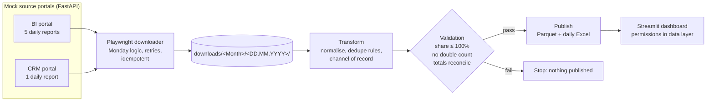
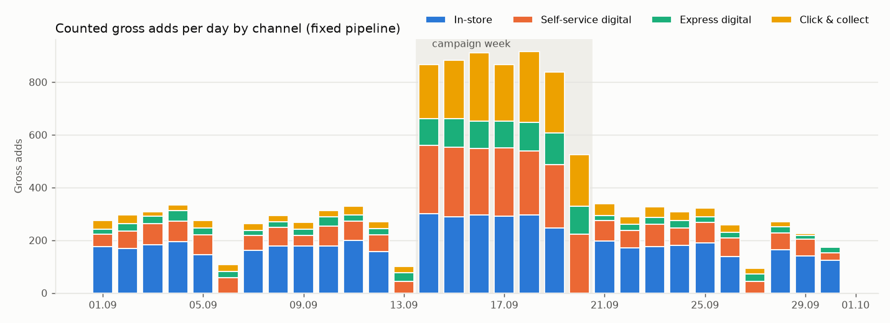
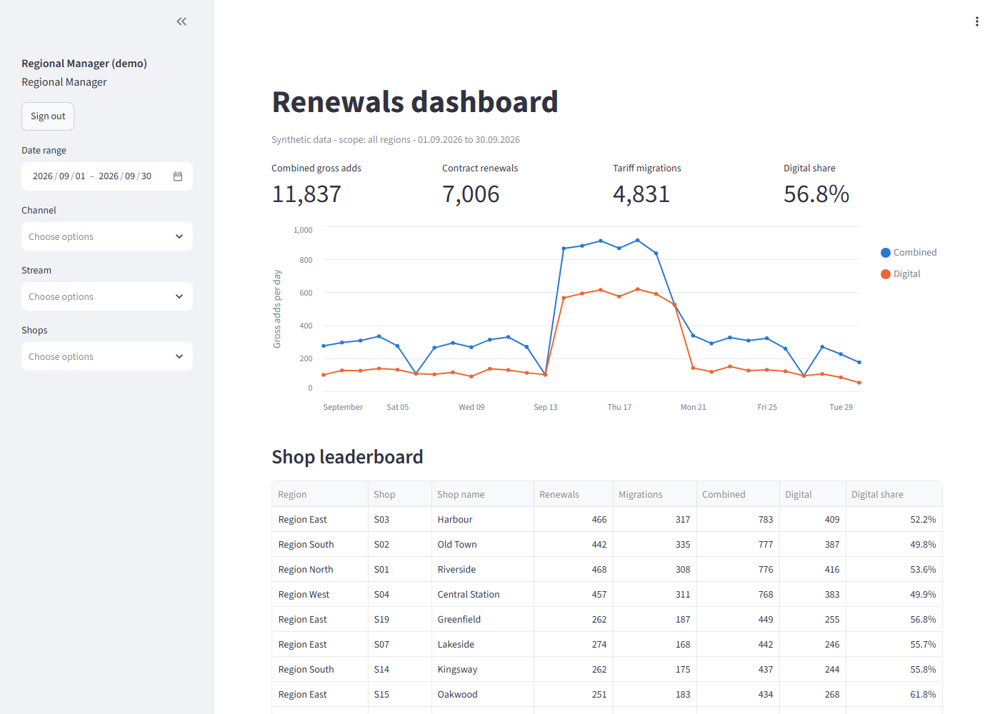
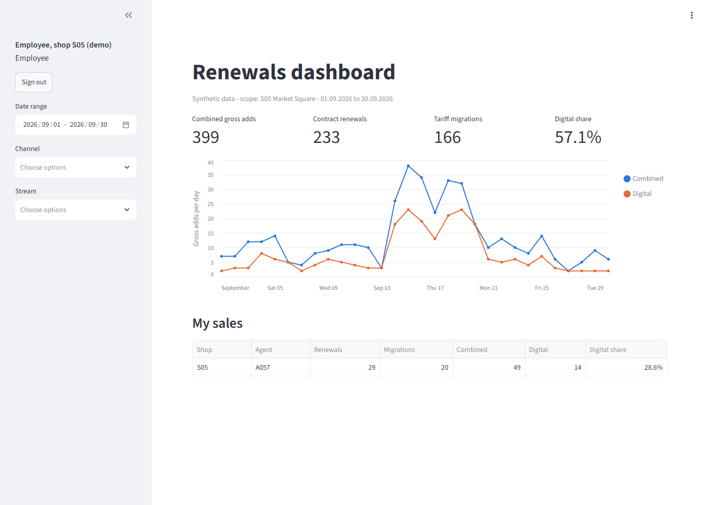
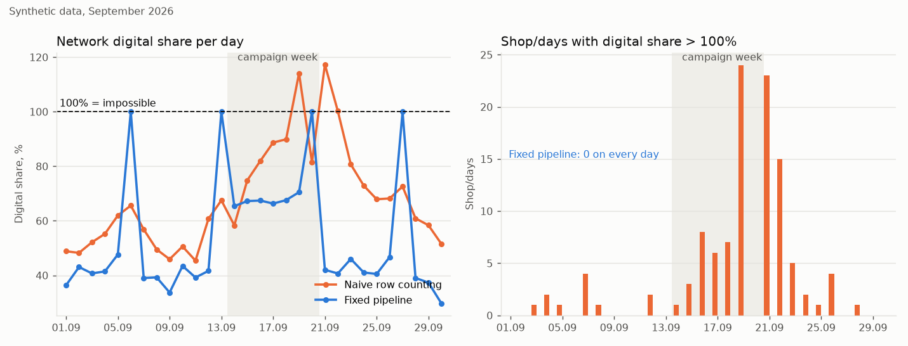

# Retail renewals reporting pipeline

[](https://github.com/GerasimoskiDesign/retail-renewals-reporting-pipeline/actions/workflows/ci.yml)

A daily sales report that used to take six manual downloads and an Excel session, rebuilt as
one command: a browser bot fetches the reports, a pipeline deduplicates and validates them, and
a role-based dashboard shows each person the numbers they are allowed to see.

*Rebuilt from scratch on synthetic data. The production version is proprietary.*

## The problem

A retail network of about 30 shops tracks two sales streams every day: contract renewals and
tariff migrations, split by channel (in-store, self-service digital, express digital,
click & collect). The daily report was put together by hand from six exports on two web
portals that have no API. The exports overlap: the same sale can appear in more than one of
them, so a straightforward row count double counts it. On normal days the effect is small
enough to look plausible, but in a busy campaign week it can push a shop's **digital share
above 100%**, which cannot happen. This pipeline is built to catch that.

## What this does



| Step | Command | What happens |
|---|---|---|
| Synthetic world | `python -m renewals generate` | Seeded generator: 4 regions, 30 shops, 188 agents, ~16.5k sales processes with four injected [data-quality traps](data/TRAPS.md) and a campaign week at ~3x volume |
| Source portals | `python -m renewals mock-portal` | BI portal (5 reports) and CRM portal (1 report), each with a login form, a date picker and a download button. *Web Orders* only exports a day-to-next-day range |
| Downloader | `python -m renewals download --run-date 2026-09-14 --headless` | Playwright signs into both portals and saves all six reports. On a Monday it fetches Friday, Saturday and Sunday as three separate days. Skips files that already exist (`--force` re-downloads), retries with exponential backoff, and writes to a local test folder unless `--real` |
| Transform | `python -m renewals transform --as-of 2026-09-30` | Recomputes the whole month from day 1, because late completions and cancellations change earlier days. Writes Parquet plus one formatted Excel report per day |
| Validation | `python -m renewals validate --as-of 2026-09-30 [--mode naive]` | Three invariants that fail loudly. `--mode naive` runs a naive row-counting baseline so you can watch it fail |
| Orchestrator | `python -m renewals run --as-of 2026-09-30` | Finds the last published day from the output file names, downloads what is missing, then transforms, validates and publishes. Logs a timed summary |
| Dashboard | `python -m renewals dashboard` | bcrypt login, three roles, filters, KPI tiles, trend chart, leaderboard and agent table |

The counting rules are written down in [`transform/rules.py`](src/renewals/transform/rules.py).
In short:

* **Unit.** One gross add is one completed process that survives every exclusion. It is
  attributed to the day the process *started* and counted once it *completes*.
* **Exclusions, in order.** `duplicate_row`, `prior_month_start`, `cancelled`,
  `superseded_by_restart`, `companion_migration`, `duplicate_contract`. Every excluded row
  keeps its reason, so the totals reconcile to the source row by row.
* **Channel of record.** Taken from *Digital Orders* by process id. The completion reports
  say `STORE` for click & collect because the hand-over happens in the shop. *Store
  Completions* pickup rows are used only to confirm the agent and are never counted again.

## Results on synthetic data

All numbers below come from running this repo on the seeded synthetic world (seed 42) for
September 2026, with data as of 30.09.2026. They are not real business figures. The full
output is in [`docs/results.md`](docs/results.md), regenerated by
`python -m renewals results --as-of 2026-09-30`.

**Naive row counting vs this pipeline**

| Period | Metric | Naive | Fixed |
|---|---|---|---|
| Whole month | Combined gross adds | 13,627 | 11,837 |
| Whole month | Digital gross adds | 10,360 | 6,719 |
| Whole month | Digital share | 76.0% | 56.8% |
| Whole month | Shop/days with digital share > 100% | 111 | 0 |
| Whole month | Contracts counted more than once | 1,342 | 0 |
| Campaign week | Shop/days with digital share > 100% | 49 | 0 |
| Campaign week | Highest shop/day digital share | 162.5% | 100.0% |

The naive logic overstates monthly volume by 15% and digital volume by 54%. Most of the
impossible shares fall in the campaign week and the three days after it, when the campaign's
click & collect orders are picked up.

**Reconciliation of the fixed logic.** Every source row is accounted for.

| Step | Rows |
|---|---|
| Source rows (Contract Renewals + Tariff Migrations) | 13,627 |
| Excluded: started in the previous month | 267 |
| Excluded: cancelled (CRM) | 448 |
| Excluded: superseded by a restart (CRM) | 58 |
| Excluded: companion migration of a counted renewal | 1,017 |
| Duplicate rows / duplicate contracts | 0 / 0 |
| **Counted gross adds** | **11,837** |



The last two days of the month are low because those sales have not completed yet. This is
the reason the month is recomputed on every run.

**Dashboard.** The regional manager sees every shop. The employee sees only their own shop
and their own agent row. The screenshots are captured by `python -m renewals screenshots`.

| Regional manager | Employee |
|---|---|
|  |  |

## Why the validation layer exists: double counting in multi-source reporting

When a report is assembled from several exports that overlap, the obvious approach is to
count rows in each one. The `naive` mode implements exactly that as a baseline:

* renewals = rows in *Contract Renewals*
* migrations = rows in *Tariff Migrations*
* digital = rows in *Digital Orders* + "Pickup" rows in *Store Completions*

Each step looks reasonable on its own, but the sources overlap. Click & collect sales are
already in Digital Orders, so adding the pickups counts every click & collect sale twice as
digital. On normal days that only inflates the share. When a campaign makes pickups
outnumber walk-in sales at a shop, digital becomes larger than the total. Two smaller
overlaps compound it: companion migrations and cancelled-then-restarted contracts are
counted as extra sales.

This is a known trap whenever overlapping sources are combined, and the pipeline is designed
around it rather than patched with a cap. Each process is counted exactly once, the channel
comes from one source of record, and the validation layer refuses to publish any shop/day
where digital > total. [`tests/test_validation.py`](tests/test_validation.py) replays both logics on
the same downloaded files. The naive logic must break the invariants during the campaign week
and the fixed logic must pass them all.



The fixed line reaches exactly 100% on Sundays. Shops are closed on Sundays, so every Sunday
sale is digital.

```text
$ python -m renewals validate --as-of 2026-09-30 --mode naive      # exit code 2
Validation (naive): FAILED
  [FAIL] digital_share_le_100: 111 shop/days with digital share > 100% (worst 200%)
  [FAIL] no_contract_counted_twice: 1342 contracts counted more than once (1363 extra)
  [ok  ] totals_reconcile: 13627 source rows = 13627 counted + 0 duplicate rows + 0 excluded
```

## Production context

The production version replaced a manual daily process of six report downloads and four scripts with a single command.

## Quickstart

You need Python 3.11+ and a few hundred MB of disk space for Chromium. The full run downloads 180
files through a real browser and takes about 1-2 minutes.

**Windows PowerShell**

```powershell
git clone https://github.com/GerasimoskiDesign/retail-renewals-reporting-pipeline.git
cd retail-renewals-reporting-pipeline
python -m venv .venv
.\.venv\Scripts\Activate.ps1          # if blocked: Set-ExecutionPolicy -Scope Process Bypass
python -m pip install -e ".[dev]"
python -m playwright install chromium
Copy-Item .env.example .env

python -m renewals generate
python -m renewals run --as-of 2026-09-30 --with-mock-portal --headless
python -m renewals validate --as-of 2026-09-30 --mode naive   # fails on purpose, exit code 2
python -m renewals results --as-of 2026-09-30                 # charts + docs/results.md
python -m pytest                                              # unit + e2e tests
python -m renewals dashboard                                  # http://127.0.0.1:8501
```

**macOS / Linux**

```bash
git clone https://github.com/GerasimoskiDesign/retail-renewals-reporting-pipeline.git
cd retail-renewals-reporting-pipeline
python3 -m venv .venv
source .venv/bin/activate
python -m pip install -e ".[dev]"
python -m playwright install --with-deps chromium   # --with-deps installs system libs on Linux
cp .env.example .env

python -m renewals generate
python -m renewals run --as-of 2026-09-30 --with-mock-portal --headless
python -m renewals validate --as-of 2026-09-30 --mode naive   # fails on purpose, exit code 2
python -m renewals results --as-of 2026-09-30
python -m pytest
python -m renewals dashboard
```

**Demo dashboard users.** These are dummy credentials for the synthetic demo. Only bcrypt
hashes are stored, in [`config/users.yaml`](config/users.yaml).

| Username | Password | Role | Sees |
|---|---|---|---|
| `regional.manager` | `demo-regional` | Regional Manager | everything, all agents |
| `manager.north` | `demo-north` | Shop Manager | Region North shops and their agents |
| `manager.south` | `demo-south` | Shop Manager | Region South shops and their agents |
| `employee.s05` | `demo-employee` | Employee | shop S05 totals and own agent row (A057) |

**Other useful commands**

```text
python -m renewals mock-portal                       # portals at http://127.0.0.1:8701/bi/login and /crm/login
python -m renewals download --run-date 2026-09-14 --headless   # Monday: fetches Fri, Sat, Sun
python -m renewals download --from 2026-09-01 --to 2026-09-03 --real --force
python -m renewals run --as-of 2026-09-30 --offline  # skip the browser, write portal files directly (fast)
python -m pytest -m "not e2e"                        # skip the browser tests
python -m renewals hash-password "new-password"      # hash for a new dashboard user
```

Exit codes: `2` validation failed (nothing published), `3` a source file is missing,
`4` downloads failed.

## Project structure

```text
.
├── .github/workflows/ci.yml       ruff + pytest (including e2e with Chromium) on ubuntu, Python 3.11
├── config/users.yaml              demo dashboard users (bcrypt hashes only)
├── data/
│   ├── TRAPS.md                   the four injected data-quality traps
│   └── reference/shops.csv        shop master data (written by `generate`)
├── docs/
│   ├── img/                       README charts and dashboard screenshots
│   └── results.md                 generated results tables
├── src/renewals/
│   ├── cli.py                     python -m renewals <command>
│   ├── settings.py                paths and .env settings
│   ├── world/                     seeded synthetic world and the traps
│   ├── portal/                    report builders, FastAPI mock portals, background server
│   ├── downloader/                Playwright bot, Monday logic, naming, plan and retry
│   ├── transform/                 source readers, counting rules, metrics, Excel writer
│   ├── validation/                invariants and the naive row-counting baseline
│   ├── pipeline.py                one month: compute, validate, publish atomically
│   ├── orchestrator.py            `run --as-of`: last published, download, publish, timings
│   ├── dashboard/                 auth, permission-enforcing data access, Streamlit app
│   └── reporting/                 README charts, results, screenshots
└── tests/                         93 tests: unit, regression, permission matrix, e2e
```

Generated at runtime and git-ignored: `data/generated/` (the world), `downloads/` (test
folder), `share/` (the `--real` folder), `output/` (Parquet and Excel reports).

## Design decisions & trade-offs

* **Sales are attributed to the start day and the month is recomputed from day 1.** Shop
  targets are set on the day the customer commits, so that is the day a sale belongs to.
  The cost is that completions arriving up to six days later change earlier days, so every
  run rebuilds the whole month. Recomputing is cheap (10-15 s for a month here) and much
  safer than incremental patching. The test-suite checks that two runs produce
  byte-identical Parquet and identical Excel cells.
* **Month close is a known limitation.** A sale started on 29 September and completed on
  2 October is excluded from October as `prior_month_start`, and September is not reopened.
  It is visible in the exclusions table, but it is not added back to September. Next step: a
  6-day re-run window for the previous month.
* **Validation blocks publishing.** Outputs are written to a staging folder and swapped in
  only after all checks pass. A late report beats a wrong one when people act on the
  numbers.
* **The companion-migration rule is a business assumption.** A migration on a contract that
  already has a counted renewal in the same month is treated as part of that sale. A
  genuinely separate migration in the same month would be absorbed. That is rare, and it
  is listed in the exclusions rather than hidden.
* **Some rules are guards that did not fire on this data.** `duplicate_row` and
  `duplicate_contract` never trigger in the synthetic month because the generator does not
  produce those cases. They are covered by unit tests because real exports do produce them.
* **Naive and fixed weekly totals are not directly comparable.** The naive logic counts by
  completion day and the fixed logic by start day. In the campaign week the naive total is
  therefore lower than the fixed one even though it is inflated overall.
* **Permissions are enforced in the data-access layer**
  ([`dashboard/access.py`](src/renewals/dashboard/access.py)), and a request for a shop
  outside the user's scope raises an error. The login itself is demo-grade: it has no rate
  limiting, no SSO and no audit log. In production I would use the company identity
  provider and row-level security in the warehouse.
* **The mock portals share one process.** The BI and CRM portals are mounted under `/bi`
  and `/crm` with separate users and cookies. The downloader only knows two base URLs, so
  pointing it at two real hosts needs only a config change. Selectors are element ids from
  the mock, and real portals would need more defensive selectors plus a screenshot on
  failure.
* **Idempotency is based on file existence.** Files are written as `.part` and renamed
  when complete, so a crash never leaves a file that looks finished. A file that was
  corrupted at the source would still be skipped. Next step: size or checksum checks.
* **Everything runs sequentially, with `PARALLEL:` notes.** The two portal sessions, the
  months and the daily workbooks are independent, and the code marks where they could run in
  parallel. The full run takes about a minute, so the extra complexity is not worth it yet.
* **`--offline`** writes the exact files the portal would serve without starting a browser.
  The test-suite uses it for speed, and only the e2e tests drive Chromium.
* **Determinism.** Every random draw comes from one seeded generator, and "today" is always
  `--as-of`. The Excel document properties are pinned to the as-of date.
* **Scale.** pandas is enough for about 14k rows a month. For years of history I would move
  the facts into DuckDB or a warehouse table and point the dashboard at that.

## Tech stack

Python 3.11, pandas, NumPy, PyArrow (Parquet), openpyxl, FastAPI + Uvicorn (mock portals),
Playwright for Python (downloader, e2e test, screenshots), Streamlit + Altair (dashboard),
bcrypt, PyYAML, python-dotenv, Matplotlib (README charts), pytest, Ruff, GitHub Actions.
